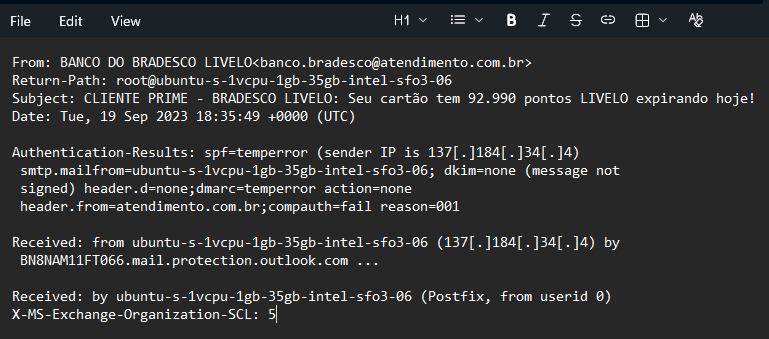
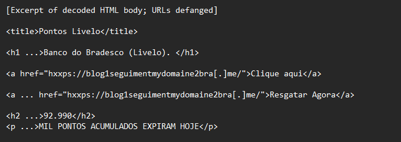
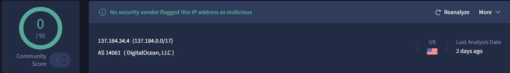

# Phishing Email Analysis: Fake Bradesco/Livelo Points-Expiry Lure

## Summary
A Portuguese-language email impersonating Banco Bradesco and the Livelo rewards program claims the recipient has 92,990 points expiring today and urges them to click a "redeem" button. The sender address uses an unrelated domain, the message was sent from a rented cloud server, no DKIM signature was present, and both links lead to an unrelated domain. Verdict: malicious (phishing).

## Sample and Handling
- Source: phishing_pot, a public phishing-sample collection (github.com/rf-peixoto/phishing_pot), file `email/sample-1.eml`
- Date analyzed: 2026-11-12
- Handling: analyzed as text only. No links were opened, no site was visited, and all indicators are defanged. The raw .eml file is not included in this repository; see the source link above.
- Tools: text editor, PowerShell (Base64 decoding), ARIN RDAP, registro.br availability check, VirusTotal (search only)

## Header Analysis
| Field | Value | Observation |
|---|---|---|
| From | "BANCO DO BRADESCO LIVELO" <banco[.]bradesco[@]atendimento[.]com[.]br> | Brand appears only in the display name; the domain is unrelated to the bank |
| Return-Path | root[@]ubuntu-s-1vcpu-1gb-35gb-intel-sfo3-06 | Does not match From; a default-style cloud server hostname |
| Sending IP | 137[.]184[.]34[.]4 | Within DigitalOcean, LLC address space (ARIN); a rented cloud server, not a mail provider |
| Mail software | Postfix, run as root (userid 0) | Self-hosted sender, not a bulk-mail platform |
| SPF | temperror (DNS timeout) | Could not be validated; the "mail from" was a hostname, not a domain |
| DKIM | none | Message not signed |
| DMARC | temperror, action=none | |
| Composite authentication | compauth=fail, reason 001 | Microsoft's combined check failed |
| Spam confidence | SCL 5 | Treated as spam by Exchange Online Protection |
| Sent / received (UTC) | 2023-09-19 18:35:49 / 18:36:44 | |

## Body and Link Analysis
The subject and body claim that 92,990 Livelo points tied to a Bradesco card "expire today" and offer airline miles and up to 35% off the card bill. This is a reward-expiry lure that uses urgency and a large number to prompt a quick click.

The "Clique aqui" link at the top (offered to show the images) and the "Resgatar Agora" (Redeem Now) button both lead to hxxps://blog1seguimentmydomaine2bra[.]me/, a domain unrelated to either brand. The only other URLs are Google Fonts references, which are benign.

Template quality problems support the verdict: a grammar error ("Você Clientes"), missing accents in the footer, duplicate `id="bg"` elements, head tags placed inside the body, and images referenced by bare file names with nothing hosted. The message has a single HTML part, no plain-text alternative, and no attachment.

## Indicator Research
Checked 2026-11-12. Registration and reputation data may not reflect September 2023.

| Indicator | Source | Result |
|---|---|---|
| blog1seguimentmydomaine2bra[.]me | VirusTotal | 0/92 flagged; tagged nxdomain and dga; registrar eNom; created approximately 3 years ago |
| blog1seguimentmydomaine2bra[.]me | Commercial registrar search | Appeared unregistered and available |
| 137[.]184[.]34[.]4 | ARIN RDAP | DigitalOcean, LLC; block 137[.]184[.]0[.]0/16 |
| 137[.]184[.]34[.]4 | VirusTotal | 0/92 malicious; 1 vendor "suspicious"; AS 14061 (DigitalOcean) |
| atendimento[.]com[.]br | registro.br | Currently registered; owner not examined |
| atendimento[.]com[.]br | VirusTotal | 0/92 flagged; tagged top-1M |

Interpretation: the link domain no longer resolves, so the site could not be examined. A clean reputation score on a dead domain is not evidence of safety. The IP belongs to a cloud provider's range, and the record shows who owns the range today, not who rented that address in 2023. The sender domain is a popular, unrelated domain, which suggests it was spoofed or misused, but the headers alone do not show whether its owner was involved.

## Indicators of Compromise
| Type | Value (defanged) | Notes |
|---|---|---|
| URL | hxxps://blog1seguimentmydomaine2bra[.]me/ | Appears twice in the body; not visited |
| Domain | blog1seguimentmydomaine2bra[.]me | Link destination; no longer resolves |
| IP | 137[.]184[.]34[.]4 | Sending server in DigitalOcean address space |
| Domain | atendimento[.]com[.]br | Sender domain; unrelated to Bradesco and Livelo; likely spoofed or misused |
| Hostname | ubuntu-s-1vcpu-1gb-35gb-intel-sfo3-06 | Sending server name |
| Email address | banco[.]bradesco[@]atendimento[.]com[.]br | Spoofed From address |

## MITRE ATT&CK
- T1566.002, Phishing: Spearphishing Link. The message delivers a link meant to lure the recipient to an attacker-controlled page.
- The email also impersonates a bank and a rewards program. I did not map this to a separate technique ID, because I could not confirm a current ATT&CK ID for impersonation in the release I checked (ATT&CK technique IDs for this behavior appear to have changed in recent releases).
- The likely goal is credential or card-data theft. This is not confirmed, because the destination site could not be analyzed.

## Verdict
Malicious (phishing). The verdict rests on the header and body evidence: a mismatched sender and Return-Path, a self-hosted Postfix server on a cloud provider, no DKIM signature, a failed composite authentication check, brand impersonation, and a link to an unrelated domain. Reputation scores added little because the indicators are old and the link domain is dead.

## Recommended Response
- Block the sender address, the sending IP, and the link domain at the mail gateway and web proxy.
- Search mail logs for other messages from the same IP or sender domain, and proxy logs for visits to the link domain.
- If anyone clicked, reset their credentials and watch the account for unusual activity.
- Report the sending IP to the hosting provider's abuse contact.
- Remind users how to spot reward-expiry and brand-impersonation lures.

## Limitations
- The sample is from 2023, so live infrastructure could not be examined.
- Domain registration history was not recoverable with free tools.
- No attachment or landing page was analyzed.
- The message was captured in a collection mailbox, so its delivery and spam score (SCL 5) say little about how a production mail filter would have handled it.

## What I Learned
Indicators from older samples expire quickly, so capturing registration data and a screenshot of the landing page at the time of an incident matters, because they may be unrecoverable later. Authentication results can also be inconclusive (SPF returned a temporary error here), so the Return-Path mismatch, the sending infrastructure, and the link destination carried the verdict.
